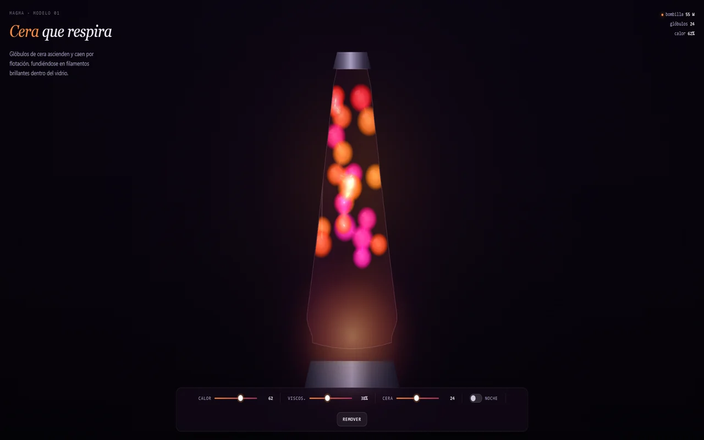

<meta property="og:title" content="MAGMA · LÁMPARA DE LAVA">
<meta property="og:description" content="Lámpara de lava interactiva en un único HTML: glóbulos de cera con temperatura propia que suben por flotación, se funden en filamentos brillantes y responden al tacto. Sin dependencias.">
<meta property="og:image" content="https://raw.githubusercontent.com/Hugopvigo/LavaLamp/main/assets/preview.webp">

<p align="center">
  
</p>

<p align="center">
  <b>Una lámpara de lava que funciona de verdad, en un único HTML.</b><br>
  Glóbulos de cera con temperatura propia que ascienden por flotación, se enfrían en el cuello y se funden en filamentos al chocarse. Todo dibujado en canvas, sin dependencias.
</p>

<p align="center">
  
  
  
  
  
</p>

---

## Qué es esto

MAGMA es una lámpara de lava que no es una animación en bucle: cada glóbulo lleva su propia temperatura, velocidad y deriva. La cera se calienta junto a la bombilla, sube, se enfría en el cuello del vaso y vuelve a bajar. Cuando dos glóbulos se tocan, aparece entre ellos un filamento brillante que los hace parecer uno solo.

Todo está en un único fichero `index.html`: CSS y JavaScript inline, sin librerías, fuentes externas ni imágenes. Funciona offline con doble clic.

## El modelo

- **Vaso cónico.** El contorno se genera muestreando la misma función de ancho que usa la física, así que los glóbulos rebotan exactamente en el cristal y se comprimen en el cuello.
- **Cera bistable.** Solo cambia de estado en los extremos: se calienta en el fondo y se enfría arriba. En el viaje mantiene su temperatura, con realimentación según la dirección. Así siempre hay glóbulos subiendo y otros bajando, sin que converjan a un punto fijo.
- **Color por temperatura.** El tono va del magenta frío (322°) al naranja caliente (28°) recorriendo el rojo, nunca el cian.
- **Fusión aditiva.** Los pares que se solapan dibujan un cuello luminoso en modo `lighter`, con opacidad y grosor según la profundidad del solape. Toda la cera va recortada al vidrio.
- **Ruido.** El contorno de cada glóbulo son dos senos sumados (3× y 5×) con fase propia, y el radio se adapta al número de glóbulos para que siempre quepan.

## Controles

| Control | Qué hace |
| --- | --- |
| **Calor** | Fuerza de flotación; también cambia la potencia de la bombilla y el resplandor de la base. |
| **Viscos.** | Amortiguación: mucha viscosidad da una cera perezosa que casi no se mueve; poca, glóbulos rápidos. |
| **Cera** | Número de glóbulos, de 6 a 44. El tamaño se reescala automáticamente. |
| **Noche** | Ciclo automático que sube y baja el calor en unos nueve segundos, para dejarlo de ambiente. |
| **Remover** | Da un impulso a todos los glóbulos y los calienta. |

También puedes tocar dentro del vaso: los glóbulos cercanos se apartan del cursor, reciben impulso vertical y se calientan.

## Cómo usarlo

Abre `index.html` en cualquier navegador moderno. No hay paso de compilación ni instalación. La versión publicada está en `https://hugopvigo.github.io/LavaLamp/`.

## Estructura

```
.
├── index.html              # simulador completo, autocontenido
├── assets/
│   └── preview.webp        # captura para el README (1280×800)
├── docs/
│   └── capturas/
│       └── og.png          # imagen Open Graph (1200×630)
├── LICENSE                 # CC BY 4.0
└── README.md
```

## Licencia

Desarrollado por Hugo Perez-Vigo · hugoperezvigo.es

Bajo [Creative Commons Attribution 4.0 International](https://creativecommons.org/licenses/by/4.0/) (CC BY 4.0). Puedes compartirlo y adaptarlo, incluso con fines comerciales, citando la autoría y enlazando la licencia. Indica si has hecho cambios.
